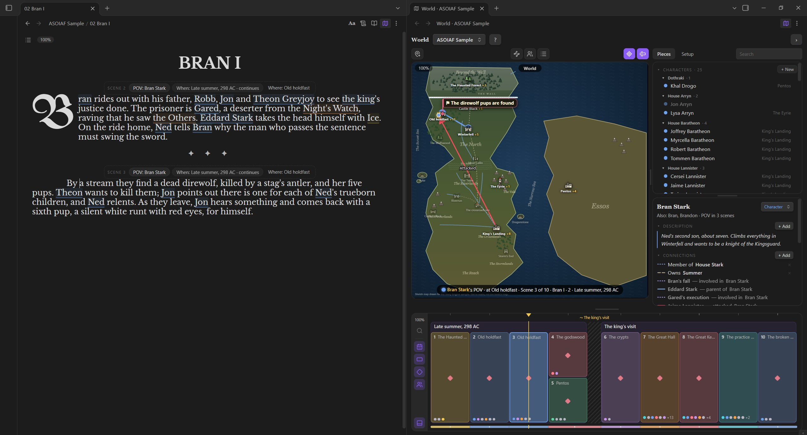
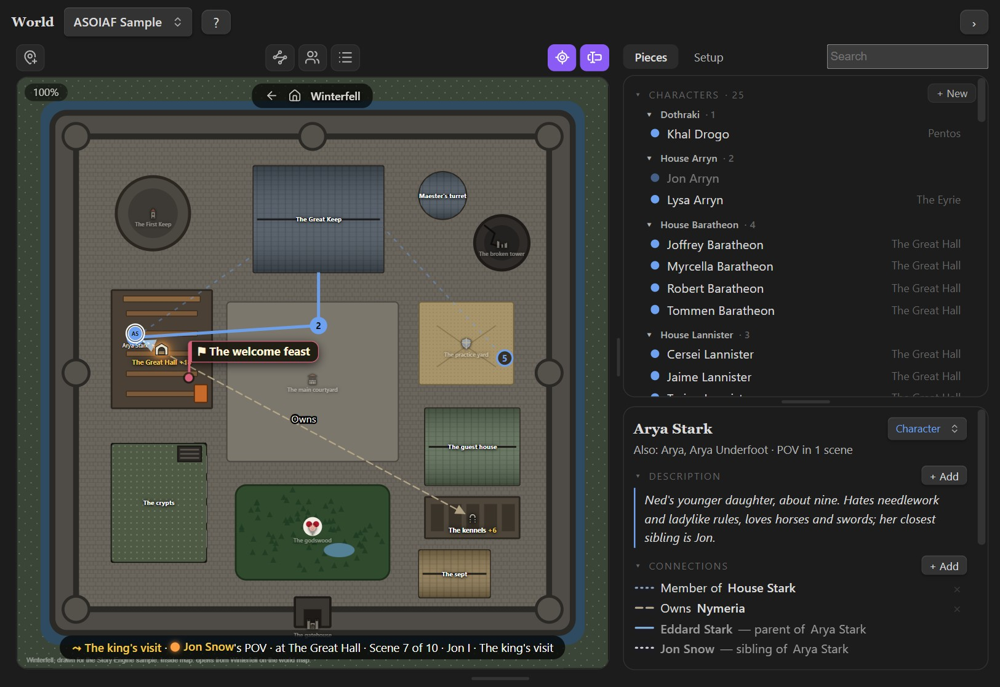
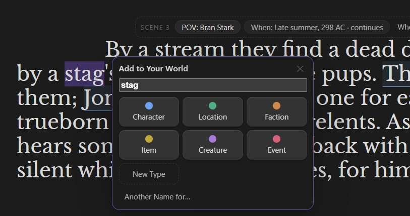
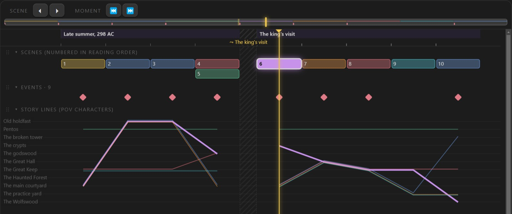
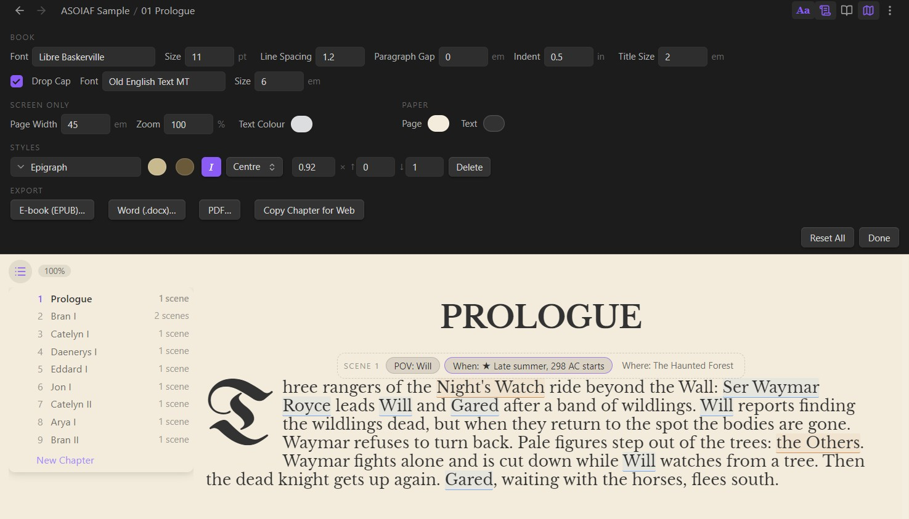

# Story Engine

Write your chapters in Obsidian with a book layout, and build your world from them: highlight a name, and it becomes a piece on your map and timeline. Fully offline.

**[Download the latest release](https://github.com/ShadowQrows/Story-Engine/releases/latest)** · the pictures below use the ASOIAF sample story (chapter summaries, not book text).



*Write on the left; the World view on the right shows where everyone is in the scene you're on. The scene bar above each scene sets its POV and when; where comes from the map.*



*Places can have their own maps. Pieces stay where you put them, scene by scene; click one for its card (description, connections, journey).*

| Highlight a name to add it | The timeline |
|---|---|
|  |  |
| *Pick what it is; a description, connections and where it is can follow.* | *Dates, time skips, scenes at the same time, and each scene's events and cast. Find lights up the scenes a character is in. Drag scenes, events and dates to change them.* |



*The book look (font, spacing, drop cap) carries into reading view and the EPUB, Word and PDF exports. Paper shows the chapter as a printed page.*

## How it's organised

- **A story is a folder** holding your chapter notes. Story Engine adds:
  - `World/` with one note per piece (`World/Characters/Bran.md`, `World/Places/Farmhouse.md`…). Each note's properties hold its type, other names, connections and themes; its text is the description (quotes from your chapters keep a link back).
  - `story-engine.json`: piece types, connection types, themes and rules, named moments, where every piece is in each scene, map positions, the book look and the World view's layout.
- **Chapters** are notes in the story folder with the book look (`cssclasses: manuscript`), in file-name order (`01 …`, `02 …`).
- **Scenes** start at each chapter title (`# TITLE`) and each scene break (`✦ ✦ ✦`). Each scene's POV and When are kept in a hidden comment at its start (`%% se-scene … %%`); the scene bar edits them for you. Where a scene happens is where its POV character is on the map.

## Story time

Scenes follow reading order: each scene is a little after the one before, unless its **When** says otherwise:

- **Continues** (the default).
- **Starts a new moment…** names this point in time ("Day 2", "The Siege"). It shows as a band on the timeline over its scenes.
- **Time skip…** asks how much time passed ("Two years later", written on the hatched break) and, optionally, what the stretch that follows is called (written on its band). Change either later by clicking the moment on the ruler (its "Time skip before it" box) or in Setup → Moments.
- **Same time as…** an earlier scene (a parallel chapter).
- **Flashback to…** a moment or an earlier scene. The map turns sepia and says what it flashes back to.

Pieces stay where they are until they're moved or marked gone. Events show only in their own scene.

## In a chapter

- **Chapters** (list button at the top left of a chapter): opens over the left margin, Google Docs style, and stays open until you click the button again; the page moves aside only if the list would cover your text. Jump to any chapter, **New chapter** at the end, drag chapters into a new order, or right-click one to rename or delete it. Files are renumbered (01, 02, …) and links to them, including description quotes, follow. A chapter's title is its `# ` line, and it follows when you rename the file.
- **Aa** (header button): the story's book look, in a strip that pushes the text down. Font, size, line spacing, paragraph gap, indent, title size, the drop cap (on or off, its font and size) also apply to reading view, printing and the exports; page width and text colour are screen-only.
- **Paper** (scroll icon next to Aa): shows the story's chapters as a book page, a light page with dark text, so you can see how it will look in print. Pick the page and text colours in the Aa strip (Paper). Writing stays the same; flip back any time.
- **Paragraph styles**: put the cursor in a paragraph (no need to highlight), right-click → **New style…**, name it (say "Epigraph") and pick its colours: one for writing, one for paper and exports. After that, right-click → **Style: Epigraph** on any paragraph, or **No style**. The Aa strip's **Styles** row changes a style everywhere at once: name, both colours, italic, alignment, size. In the chapter the style is a hidden `%%style:epigraph%%` at the start of the paragraph (you never see it in the book look). Enter in the middle of a styled paragraph keeps the style on both halves.
- **Export** (Aa strip, or the command palette): **E-book (EPUB)** and **Word (.docx)** build the whole story, every chapter in order, into the story's `Exports` folder. You give a title, author and language the first time (remembered). The EPUB carries the book look (Libre Baskerville and the blackletter drop cap are embedded), chapter titles, scene breaks, a table of contents and your styles with their paper colours; e-readers may still let readers change fonts, and e-ink shows colours as grey. The Word file has real styles (Heading 1 chapters, Body Text, Scene Break, and each of your styles with its colour), ready for Atticus, Vellum, Word or Google Docs. The chapter's first letter is a drop cap like the book look's, in a box the text flows around, using Old English Text MT if that's on your computer and otherwise the bundled blackletter. Libre Baskerville and the bundled blackletter are embedded in the file, so it looks the same on any computer. **PDF** lays the whole book out on real book pages (6 × 9 in by default; also 5.5 × 8.5, 5 × 8, A5, or Letter / A4 for a manuscript), with the book look, the drop cap, your styles, a title page, each chapter on a new page and page numbers; margins are the same on every page, or mirrored (wider on the binding side) when you tick **Mirrored margins** for a printed book. It's saved in `Exports`. It's printed by Obsidian's own engine on desktop (on a phone, the print dialog opens instead: choose Save as PDF). The page size you pick is used by the Word file too. **Copy chapter for web** puts the chapter on the clipboard as formatted text for Royal Road, Wattpad, AO3 and similar: italics, bold, scene breaks and your styles' colours (sites keep what they support).
- **Highlight a name** (up to four words; longer highlights are left alone so you can format them, and right-click → **Add to World…** takes a whole passage) → the capture box: pick a type (or "+ New type"), then (all skippable) highlight or type a description, click/highlight/type who it's connected to and pick a connection type (or "+ New connection type"), and finally where it is: the box suggests a spot (for example "With Bran and Gared at the Farmhouse") with the mini-map right under it. Click the suggestion or Done to accept it, or click your own spot on the mini-map (it opens zoomed on the suggestion; "Whole map" shows everything). If the scene has no place yet, the place you pick becomes the scene's place. Time is always the scene you're in. **Finish**, **Esc** or clicking elsewhere keeps what's there; **Undo** (in the box or the notice afterwards) removes it.
- **Click an underlined name** → add to its description, add a connection, "here in this scene", "dead from this scene on", "gone from this scene on", make it the scene's POV, or show its card.
- **Scene bar**: set the scene's POV and When. **Where** fills itself in from the map; click it to see the POV character there.
- **New Scene** (the button under Chapters): a scene break at the cursor, splitting the paragraph if you're in one, then the new scene's POV picker.
- **Bold, Italic, Strikethrough**: the buttons in the middle of a chapter's header, or Ctrl+B / Ctrl+I, on the selection or the word at the cursor. In chapters the marks themselves (`#`, `**`, `*`, `~~`) are never shown, and Backspace, Delete and Enter keep them whole.
- **One line is one paragraph**, like a word processor: Enter starts a new, indented paragraph, and an empty line is one line of space on the page (Enter twice). What you see is exactly what's in the file, so nothing jumps when you click or select. Pasted text is tidied the same way. Stories from before 2.11 (an empty line between paragraphs, as plain Markdown does) are converted once when they open; the originals are copied to the story's `Backups/Before 2.11` folder. A note switched to the book look is converted the same way (original in `Backups/Before book look`).
- **Zoom** (screen only): hold Ctrl and scroll (or pinch on a trackpad) over a chapter to make the page bigger or smaller, 30%–300%; the size shows next to the Chapters button (click it for 100%). It's also in the Aa strip (Screen only → Zoom) and in the command palette (Zoom in / out on chapters, Reset chapter zoom). It's saved on this computer and never changes the book itself or the exports.
- **Opening a chapter** puts the cursor at the start of its first paragraph (a new chapter: the line below its title). Switching from reading view to editing keeps your place, with the cursor at the first paragraph on screen. The book look is drawn from the very first moment, with no flash of a plain note.

## World view (map button in every note's header, left of ⋮: click to open, again to close)

- **Map** (square): wheel zooms toward the pointer · hold **Space** and drag to pan · drag on empty map to box-select (Shift adds) · drag a selected piece to move the whole selection · drop on a place to put pieces there from this scene on · **right-click** for "New location here" / "New character here" · **Location mode** adds a location with every click. The scene's POV piece glows; the selected piece's journey is drawn (past solid, future faint). **Legend** (toolbar toggle) lists only what's on the map.
- **Places have areas.** Every place has an area (a circle to start with). Drop a piece anywhere inside it and it's at that place, at exactly that spot; if the place moves later, everyone in it moves along. Pieces with no chosen spot are arranged loosely around the place. Where areas overlap or nest (a hall inside a castle), the smallest one wins. Areas show while you drag a piece, when you hover a place, and for the selected place. To reshape one, right-click the place (or use its card): **Edit its area** (drag points; click ＋ on an edge to add one; right-click a point to remove it; drag inside to move it; the corner handle resizes) or **Draw a new area** (click around the border, then click the first point). Points snap to neighbouring places' corners and edges so borders meet with no gap and no overlap; hold Shift to place them freely.
- **Every piece has a fixed spot on the map**; zooming only changes how big it's drawn. Pieces that were never given a spot get a steady one inside their place's area (the same every time, whoever else is there) until you drag them. Zoomed right out, tokens are about the size of a place's dot; names show on hover.
- **The toolbar** above the map has icon toggles (dark when off, purple when on; hover for the name) in three groups: **Location mode** on the left; **All lines**, **Show pieces** and **Legend** in the middle; **Follow scene** and **Follow cursor** on the right. The zoom shows in the map's top-left corner (100% = the whole map); click it to fit. The map's name is at the top centre: "World", or **←** (out one level) · **⌂** (the world map) · the name of the map you're in.
- **Place markers.** On the world map zoomed out below 200% (change it in Setup → Maps), and anywhere a place's pieces (three or more) would overlap or spill out of its area, the place folds into a marker: its icon, its name and "+N". If the POV is in there, the marker glows. Hover the marker to see everyone at their real spots (the POV glows among them); click it to zoom in until they fit; double-click it to go inside the place's own map. Anything selected stays out. **Show pieces** unfolds every marker, for following journeys. Fully zoomed out, tokens are tiny dots with no letters.
- **Every location always shows**: its icon and name, see-through while nobody is there (or in a smaller location inside it), solid when someone is. Markers look the same, plus the "+N", so nothing pops in and out. Pick an icon from the location's card (**Icon…**) or by right-clicking it or its marker: about 40 built-in drawings (castles, towers, houses, inns, cities, temples, gates, walls; great halls, throne rooms, bedrooms, kitchens, libraries, forges, stables, armouries, dungeons, crypts, stairs, doors; forests, a great tree, mountains, caves, islands, lakes, fields…), or any image in your vault. Without one, a location is a dot in its type's colour.
- **Event flags step aside**: while the pointer is over a location or a piece (or you're dragging something), flags turn see-through and clicks go through them. A flag answers only when the pointer is on the flag itself and no piece or location icon is under it.
- **Events are headlines**: a flag with the event's title at the spot where it happens, in its scene, readable at any zoom. Click it for its card; everyone involved gets a dashed ring.
- **Ctrl+Z / Ctrl+Shift+Z** (with the World view focused) undo and redo what you do there (moving pieces and places, areas and roofs, timeline drags, card edits, deleting pieces, renaming themes…), and say what was undone. **Delete** takes the selected pieces off the map. Right-click a piece on the map or in the list for its menu (show card, rename, remove from map, delete); drag a piece from the list onto the map to place it. Double-click a typed description or a connection on a card to change it.
- **Broken links**: if a scene's hidden settings or a note's id get deleted, a **broken links** button appears at the top of the World view; it lists what lost its place and reconnects it in one click (by name, or by the scene's opening words).
- Dragging a place takes its area, its roof, its events and everyone in it along, shown live while you drag. A plain click selects just that piece; dragging moves everything selected only when several are selected (a hint says how many).
- **Inside maps**: right-click a place (or use its card) to give it its own map, such as a castle plan or a city. The World view switches to whichever map the scene is on (the scene's place, or where its POV is), and ← / ⌂ at the top of the map take you out again. On the outer map, everyone inside shows at that place. Double-click a place with an inside map to go in. To put a piece inside without going in, drag it onto the place and hold still: its inside map pops up to drop it on.
- **Roofs**: right-click a building (or use its card) and trace its outline to give it a roof of any shape, optionally with a picture. A roof hides who's inside (showing a count) until the scene's POV character, or the scene itself, is in there. Hover a roof to peek; click it to open it.
- **Right column**: **Pieces** (search, catalog, and the selected piece's card. Every section of the catalog and of the card folds: click its title. Card sections stay folded for every card. Characters, and any other type, are grouped by faction: a piece with a **Member of** connection to a faction shows under it (in each, if several), the rest under "No faction". **Dead** lists everyone who has died by the scene you're on, with the scene; double-click one to go there. The card's **Dies here** marks a death: the piece stays on the map where it died, faded with a ✝, as a landmark; **Undo death** undoes it. **+ New** (top right of the catalog) adds a piece that isn't named in the text yet. In the card: click "+ Add", then highlight in a chapter to add a description or a connection; × removes a quote or connection) and **Setup** (piece types with what they do: **Movable**, **Location** or **Event**; connection types with their lines, themes and rules with their meaning, moments, the maps (and below which zoom locations fold into markers), copying definitions from another story; paste comma- or line-separated lists to add many at once). Deleting anything asks once more on the same button. The › / ‹ button at the top right of the World view hides and shows the column; the map then uses the space. The column can't be dragged narrower than its contents.
- **The caption under the map** says whose POV it is, where they are, and which scene and moment, with a short note when the story jumps in time. Double-click it to focus the map on the POV's place (and follow the scene again).
- **Follow scene** (toolbar toggle, at the right): on, the map follows the scene, the map switches to wherever each scene is; choosing a map yourself (← / ⌂, double-clicking a place) switches to staying on it while you step through scenes.
- **Your words for scene and moment**: Setup → Timeline, click "Scene" or "Moment": a small box opens with the word and its plural (guessed as you type). ↺ puts the original back. It changes everywhere.
- **Timeline** (bottom, resizable): dates run along the top, each scene is a box under its date (scenes at the same time share the space), with its events and who is there inside it. The column on the left: the zoom (click to fit), **Find** (pick characters and places: the scenes where they are light up, gold where they're all together), and switches for dates, scenes, events, cast and the overview strip. Wheel scrolls sideways, Ctrl+wheel zooms. Drag along the ruler to move the playhead; ←/→ or , and . step through scenes, Shift to jump between dates. Drag scenes, events and dates to change them; click a date to rename it, add a note or make it a time skip. The thin strip at the bottom is the whole story, lined up with the timeline at 100%.

## Development

```bash
npm install
npm run build     # → release/story-engine/
npm test          # model + book-layout unit tests
npm run test:ui   # the real plugin + real CodeMirror in Chromium with a stand-in for Obsidian
node tests/perf.cjs   # timing on a 600-scene story (after npm run test:ui or node build.mjs harness)
```

Bundled fonts: Libre Baskerville and UnifrakturMaguntia, SIL Open Font License 1.1.

## Obsidian's status bar

Story Engine adds a small arrow to Obsidian's status bar (word count, backlinks…). Click it to fold the bar away; click again to bring it back.
